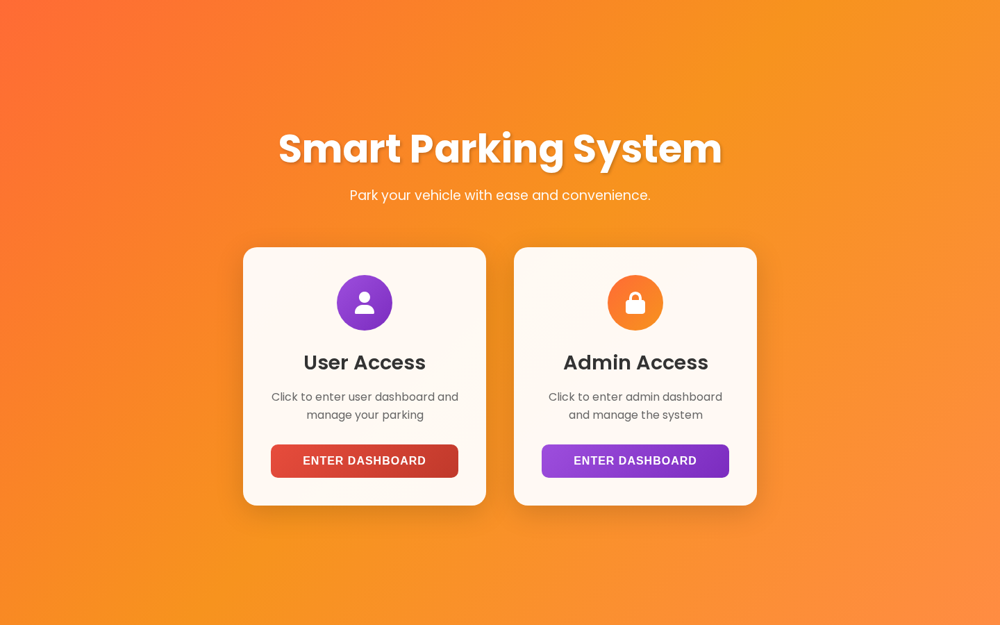
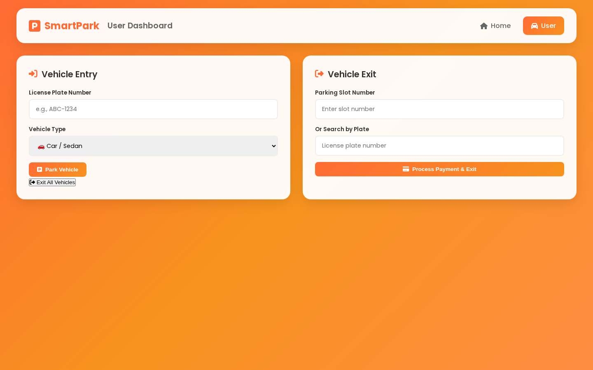
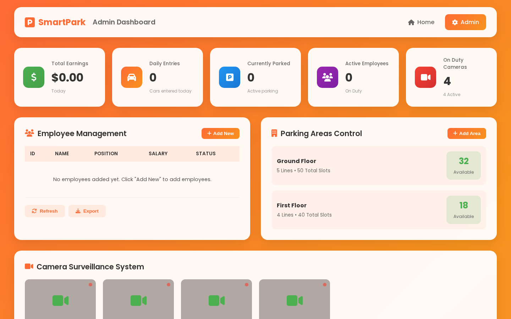
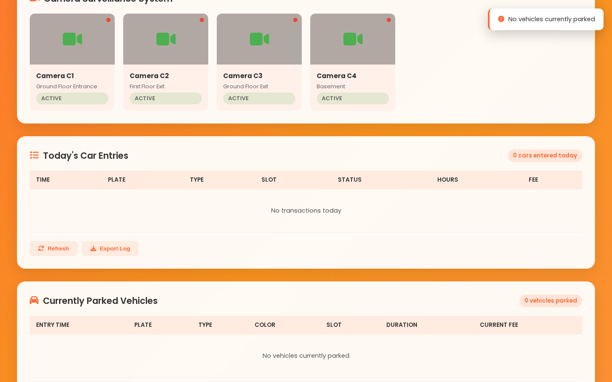
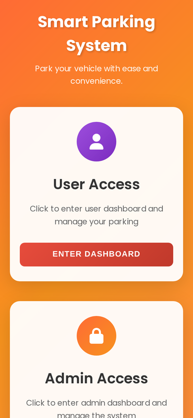

<h1 align="center">Smart Parking System</h1>

<p align="center"><em>Parking management with user & admin dashboards</em></p>

<p align="center">
  
  
  
  
</p>

<p align="center"><a href="https://parkingsystem-78.netlify.app/"><strong>🔗 Live Demo</strong></a></p>

<p align="center"></p>

## 📖 Overview

A parking management project focused on organizing parking operations and providing a structured digital experience for managing parking information using C++ and data structures. This repository contains the project's web interface: a landing page with **User** and **Admin** access, a user dashboard for parking and exiting vehicles, and an admin dashboard for managing the whole facility.

## ✨ Features

- Landing page with separate **User** and **Admin** entry points
- **Vehicle entry** — license plate + vehicle type (car, SUV, truck, motorcycle, electric)
- **Vehicle exit** by slot number or plate search, with payment processing
- Parking **fee calculation** ($5 per hour) and duration formatting
- **Admin dashboard** — total earnings, daily entries, currently parked vehicles, active employees
- **Employee management** table
- **Parking areas control** — floors, lines and available slots
- **Camera surveillance** panel (4 cameras)
- Today's entries log and currently parked vehicles table
- Talks to a REST backend at `http://localhost:18080`, with built-in mock data when the backend is offline

## 🛠️ Tech Stack

| Layer | Technology |
|---|---|
| Core logic | C++ & data structures |
| Web UI | HTML5, CSS3, Vanilla JavaScript |
| Icons & fonts | Font Awesome, Poppins |
| API | REST (JSON) on localhost:18080 |
| Hosting | Netlify |

## 📸 Screenshots

**Home**


**User Dashboard**



**Admin Dashboard**



**Admin Parking Areas**



**Mobile**



## 🌐 Live Demo

https://parkingsystem-78.netlify.app/

## 🚀 Getting Started

No build step needed — it's a static site.

```bash
git clone https://github.com/Mo-aini/smart-parking-system.git
cd smart-parking-system
```

Then open `index.html` in your browser, or serve the folder locally:

```bash
# Option 1: Python
python -m http.server 8000
# Option 2: Node
npx serve .
```

Visit `http://localhost:8000`. You can also use the **Live Server** extension in VS Code.

The dashboards call a backend at `http://localhost:18080`. If it isn't running, the interface falls back to mock data so you can still explore it.


## 📁 Project Structure

```
smart-parking-system/
├── screenshots/
│   └── … (5 files)
├── .gitignore
├── admin-style.css
├── admin.html
├── index.html
├── LICENSE
├── README.md
├── script.js
├── style.css
└── user_dashboard.html
```

## 📝 Notes

This repository contains the web interface as deployed. The C++ backend is not part of the deployed site.

---

<div dir="rtl">

## 🇾🇪 بالعربي

نظام إدارة مواقف سيارات — مشروع C++ وهياكل البيانات. هذا الـ repository فيه واجهة الويب: صفحة دخول للمستخدم والأدمن، لوحة المستخدم (إدخال سيارة برقم اللوحة ونوعها، وإخراجها ودفع الرسوم)، ولوحة الأدمن (الأرباح، السيارات الداخلة اليوم، الموظفين، الطوابق والمواقف المتاحة، والكاميرات).

**التشغيل:** افتح `index.html` بالمتصفح.

**الرابط المباشر:** https://parkingsystem-78.netlify.app/

</div>

---

## 👤 Author

**Mohammed Emad ALaini** — Software Engineering student & Full-Stack Developer

- Portfolio: [mohammedemad.netlify.app](https://mohammedemad.netlify.app/)
- GitHub: [@Mo-aini](https://github.com/Mo-aini)
- LinkedIn: [Mohammed Emad](https://www.linkedin.com/in/mohammed-emad-24a841373)

## 📄 License

This project is licensed under the [MIT License](LICENSE).
